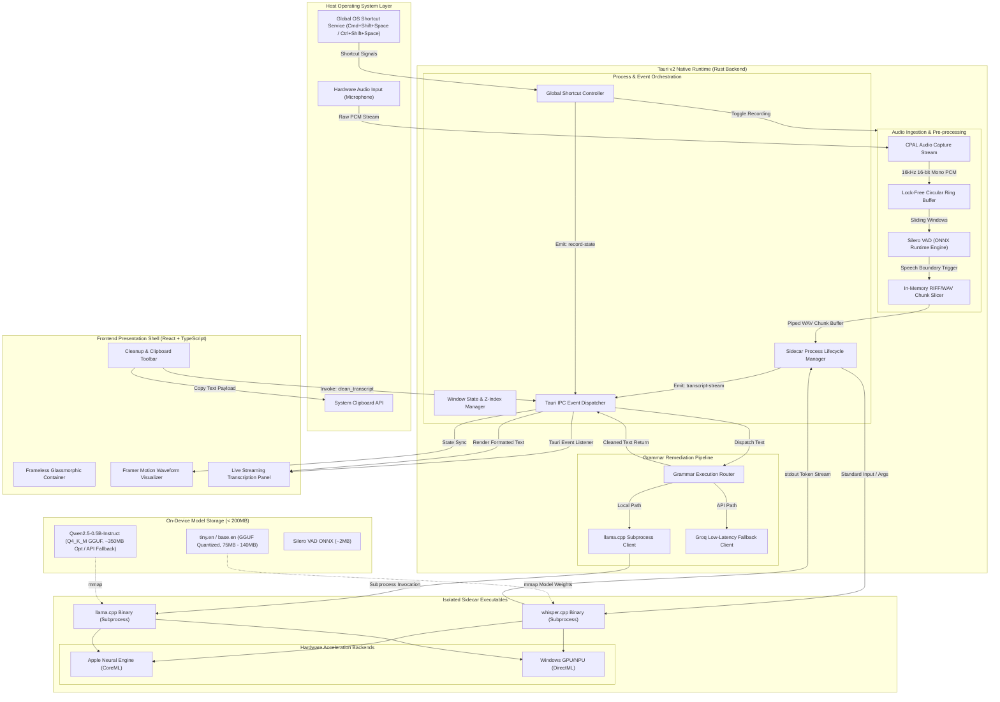
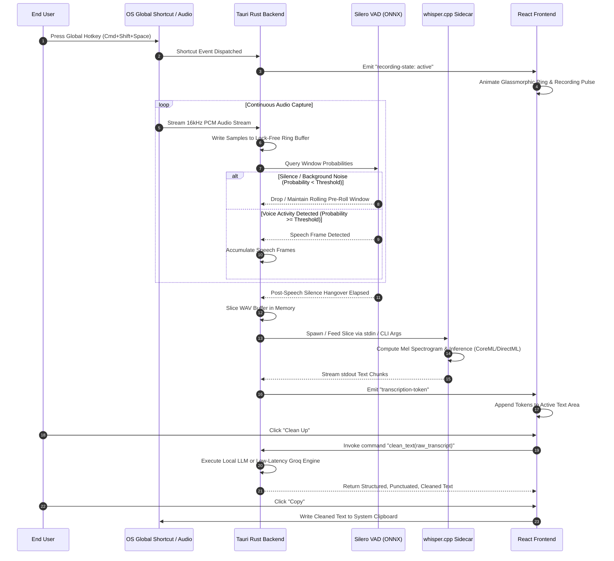

# OmniScribe Edge

**Master Project Specification & Implementation Blueprint**

OmniScribe Edge is a featherweight (under 200MB total footprint), 100% on-device, ultra-low-latency live speech-to-text (STT) desktop application with integrated local grammar correction. Engineered using Tauri v2, native Rust audio pipelines, and quantized neural engine sidecars, the application guarantees zero cloud reliance, sub-second transcription latency, and native hardware-accelerated inference across Apple Silicon and Windows ARM64/x64 architectures.

---

## 1. Executive Summary & Core Constraints

### 1.1 Objective
Deliver a production-ready, local-first dictation and transcription utility that operates without network access, preserves absolute user privacy, and integrates seamlessly into desktop workflows through a floating, frameless glassmorphic interface.

### 1.2 Performance & Budgetary Constraints
* **Total Binary & Asset Footprint:** Under 200 MB combined (Tauri v2 host binary, whisper.cpp sidecar binary, quantized GGUF weights, and static assets).
* **Latency Profile:** Sub-second response time from end-of-speech detection to rendered transcript.
* **Network Independence:** Zero cloud reliance for transcription and core features; air-gapped security compliance.
* **Hardware Acceleration Targets:**
  * Apple Silicon: M-Series Neural Engine via CoreML backend compilation.
  * Windows: Qualcomm Snapdragon ARM64 and AMD/Intel x86_64 via DirectML backend compilation.
* **Form Factor:** Frameless, borderless, floating glassmorphic overlay adhering to native macOS and modern Windows visual paradigms.

---

## 2. High-Organization System Architecture

The following diagram details the multi-tier architectural topology of OmniScribe Edge, highlighting process boundaries, inter-process communication (IPC), hardware acceleration routes, and data ingestion paths.



---

## 3. End-to-End Data Flow & State Machine

The runtime transitions through strict lifecycle states to prevent thread contention, buffer overruns, and audio hallucination during non-speech segments.



---

## 4. Technical Stack Specifications

### 4.1 Application Framework
* **Tauri v2:** Rust-based desktop orchestration framework. Eliminates Chromium and Node.js runtimes to keep memory consumption below 60MB RAM and compiled binary footprints under 15MB.
* **Rust Toolchain:** Stable channel, 2021 edition, with multi-threaded async execution powered by Tokio.

### 4.2 Frontend Architecture
* **View Layer:** React 18 with TypeScript.
* **Styling Engine:** Tailwind CSS configured with custom backdrop-filter and HSL-based alpha-channel extensions.
* **Animation Suite:** Framer Motion for hardware-accelerated micro-interactions, layout transitions, and pulsating audio meters.
* **Component Primitives:** Radix UI unstyled accessibility primitives.

### 4.3 Audio Capture & Voice Activity Detection (VAD)
* **Audio Input Library:** `cpal` (Cross-Platform Audio Library) capturing standard 16,000 Hz, 16-bit, mono channel PCM audio streams.
* **Buffer Management:** Thread-safe, lock-free ring buffer maintaining a 200ms pre-roll and 500ms post-roll hang-over.
* **VAD Engine:** Silero VAD packaged in ONNX format (~2MB), executed via `ort` (ONNX Runtime bindings for Rust). Slices speech into discrete boundaries to eliminate hallucination during zero-amplitude frames.

### 4.4 Speech-to-Text Engine
* **Inference Core:** `whisper.cpp` compiled as a relocatable external sidecar binary.
* **Model Topology:** OpenAI Whisper `tiny.en` (~75MB) or `base.en` (~140MB) quantized to GGUF format.
* **Acceleration Bindings:**
  * macOS: `-DWHISPER_COREML=ON` utilizing the Apple Silicon Neural Engine (ANE).
  * Windows: `-DWHISPER_DIRECTML=ON` offloading to local DirectX 12 compatible NPUs and GPUs.

### 4.5 Grammar Correction & Post-Processing
* **Primary (Local Execution):** `llama.cpp` sidecar executing Qwen2.5-0.5B-Instruct in 4-bit quantization (Q4_K_M).
* **Secondary (Low-Storage Compliance):** High-speed fallback API (Groq running Llama-3.1-8B-Instant) for environments demanding strict under-200MB total disk boundaries where local LLM weights cannot be stored.
* **Operations:** Filler word removal ("um", "uh", "like"), punctuation restoration, capitalizing proper nouns, and context-aware sentence restructuring.

### 4.6 Product Web Asset
* **Framework:** Next.js 14 (App Router) with static export capability (`output: export`).
* **Design Aesthetic:** Editorial dark-mode aesthetic featuring deep charcoal backdrops, interactive canvas grids, and instant download matrices.

---

## 5. Memory, Storage & Latency Budget

To strictly honor the 200MB total distribution limit while providing real-time responsiveness, assets and resources are allocated according to the matrix below:

| Component | Storage Size | Runtime Memory (RAM) | Primary Execution Target |
| :--- | :--- | :--- | :--- |
| Tauri Host Binary (Stripped) | 12 MB | 25 MB - 40 MB | CPU (Native Thread) |
| Web UI Assets (Static bundle) | 2.5 MB | Shared WebView | WebKit / WebView2 |
| whisper.cpp Sidecar Executable | 4.8 MB | 15 MB | CPU / Subprocess |
| Silero VAD ONNX Model | 1.8 MB | 10 MB | CPU / ONNX Runtime |
| Whisper `tiny.en` Model (GGUF) | 75.0 MB | 110 MB | Apple Neural Engine / DirectML |
| Dynamic Libraries (CoreML / ONNX) | 45.0 MB | Shared Virtual Mem | OS Dynamic Linker |
| Application Config & Caches | < 1.0 MB | < 2 MB | Local Storage |
| **Total Core Configuration** | **~142.1 MB** | **~160 MB - 190 MB** | **Sub-200MB Target Met** |

*Note: When opting for the optional local grammar correction model (Qwen2.5-0.5B at ~350MB), the application enables an dynamic on-demand model downloader. For strict zero-download, single-package distribution under 200MB, the default configuration utilizes Whisper `tiny.en` with the low-latency API endpoint for grammar cleanup.*

---

## 6. Repository Layout

```
OmniScribe-Edge/
|-- .gitignore
|-- README.md
|-- package.json
|-- apps/
|   |-- desktop/                          # Tauri v2 Desktop Application
|   |   |-- package.json
|   |   |-- tsconfig.json
|   |   |-- vite.config.ts
|   |   |-- index.html
|   |   |-- src/                          # React Frontend Shell
|   |   |   |-- main.tsx
|   |   |   |-- App.tsx
|   |   |   |-- index.css
|   |   |   |-- components/
|   |   |   |   |-- GlassContainer.tsx    # Frameless floating shell
|   |   |   |   |-- RecordButton.tsx      # Reactive pulse trigger
|   |   |   |   |-- AudioVisualizer.tsx   # Framer Motion soundwave
|   |   |   |   |-- TranscriptArea.tsx    # Streaming text display
|   |   |   |   |-- ActionToolbar.tsx     # Clean up and clipboard controls
|   |   |   |-- hooks/
|   |   |   |   |-- useAudioCapture.ts
|   |   |   |   |-- useTauriEvents.ts
|   |   |   |-- types/
|   |   |       |-- transcript.ts
|   |   |-- src-tauri/                    # Rust Native Host
|   |       |-- Cargo.toml
|   |       |-- tauri.conf.json           # Window transparency & sidecars
|   |       |-- build.rs
|   |       |-- bin/                      # Compiled sidecar target folder
|   |       |   |-- whisper-sidecar-aarch64-apple-darwin
|   |       |   |-- whisper-sidecar-x86_64-pc-windows-msvc.exe
|   |       |-- models/                   # Quantized offline weights
|   |       |   |-- ggml-tiny.en-q5_1.bin
|   |       |   |-- silero_vad.onnx
|   |       |-- src/
|   |           |-- main.rs
|   |           |-- lib.rs
|   |           |-- audio/
|   |           |   |-- capture.rs        # CPAL stream manager
|   |           |   |-- ring_buffer.rs    # Circular buffer
|   |           |   |-- vad.rs            # Silero ONNX evaluation
|   |           |   |-- wav.rs            # Memory WAV serialization
|   |           |-- engine/
|   |           |   |-- sidecar.rs        # Subprocess lifecycle & stdout
|   |           |   |-- grammar.rs        # Text post-processing router
|   |           |-- commands/
|   |           |   |-- recording.rs      # Tauri invocable methods
|   |           |   |-- clipboard.rs
|   |           |-- state.rs              # AppState & atomic flags
|   |-- web/                              # Product Marketing Asset
|       |-- package.json
|       |-- next.config.mjs
|       |-- tailwind.config.ts
|       |-- tsconfig.json
|       |-- app/
|           |-- layout.tsx
|           |-- page.tsx
|           |-- globals.css
|           |-- components/
|               |-- HeroSection.tsx
|               |-- DesktopDemoMock.tsx
|               |-- DownloadMatrix.tsx
|               |-- ArchitectureDeepDive.tsx
|-- scripts/                              # Compilation & packaging utilities
|   |-- setup_sidecars.sh                 # Sidecar build automator
|   |-- download_models.sh                # Weight verification & download
```

---

## 7. Subsystem Deep Dive & Implementation Details

### 7.1 Window Shell & Glassmorphic Styling
To achieve the native macOS floating widget aesthetic without borders or chrome:

1. **Tauri Window Attributes (`tauri.conf.json`):**
   ```json
   {
     "app": {
       "windows": [
         {
           "title": "OmniScribe Edge",
           "width": 420,
           "height": 580,
           "resizable": false,
           "decorations": false,
           "transparent": true,
           "alwaysOnTop": true,
           "skipTaskbar": false,
           "shadow": true
         }
       ]
     }
   }
   ```
2. **Glassmorphic Layering:**
   The top-level container applies an explicit frosted-glass composition using:
   ```css
   .glass-container {
     background: rgba(18, 18, 22, 0.65);
     backdrop-filter: blur(20px) saturate(180%);
     -webkit-backdrop-filter: blur(20px) saturate(180%);
     border: 1px solid rgba(255, 255, 255, 0.08);
     box-shadow: 0 20px 40px -15px rgba(0, 0, 0, 0.5),
                 0 0 0 1px rgba(255, 255, 255, 0.05) inset;
   }
   ```

### 7.2 Audio Ingestion & Silence Slicing
* The `cpal` worker thread samples the default input hardware at 16,000 Hz (single channel, float32 normalized).
* Samples are continuously pumped into an atomic circular ring buffer.
* The Silero VAD processor operates on fixed 512-sample blocks (32ms per frame). A probability rating is generated per block:
  * Speech Start: Probability > 0.55 sustained over 3 consecutive frames triggers an active audio segment.
  * Speech End: Probability < 0.35 sustained over 400ms marks the termination of speech.
* Upon termination, the buffered samples (including a 150ms pre-roll to prevent front-clipping of plosives) are converted to a 16-bit linear PCM WAV container in memory.

### 7.3 whisper.cpp Sidecar Bridge
* The Rust orchestrator maintains a reference to the compiled `whisper.cpp` sidecar executable using Tauri's `tauri::async_runtime::spawn` and `tauri::plugin::shell::ShellExt`.
* Arguments passed ensure streaming stdout emission:
  ```bash
  whisper-sidecar --model models/ggml-tiny.en-q5_1.bin --step 500 --length 3000 -t 4 -np -nt
  ```
* Standard output lines are parsed by regular expression to remove progress metadata and timestamps, streaming clean token strings straight to the frontend via Tauri IPC events:
  ```rust
  app_handle.emit("transcript-stream", payload)?;
  ```

### 7.4 Grammar Cleanup Pipeline
* The "Clean Up" module accepts the raw transcription string and executes a targeted prompt:
  ```
  [INST] System: You are an expert speech editor. Remove speech disfluencies, filler words (um, uh, like), fix punctuation, and correct casing. Retain original vocabulary and intent without editorial commentary.
  Raw: {RAW_TRANSCRIPTION}
  Cleaned: [/INST]
  ```
* Output is streamed back to replace the raw buffer and automatically presented with an instant copy action button.

---

## 8. Step-by-Step Execution Plan

### Phase 1: Environment & Framework Initialization
* Scaffold the Tauri v2 monorepo using React and TypeScript templates.
* Configure `tauri.conf.json` with transparency, frameless decorations, fixed dimensions (420x580), and `alwaysOnTop: true`.
* Initialize Tailwind CSS with custom alpha-channel variables and backdrop blur utility classes.
* Implement the baseline UI: frameless container, titlebar drag region, central record trigger, and transcript window.

### Phase 2: Global State & OS Integration
* Integrate `@tauri-apps/plugin-global-shortcut` and configure standard OS triggers (`Cmd+Shift+Space` on macOS, `Ctrl+Shift+Space` on Windows).
* Create an atomic state struct in Rust to guard recording lifecycle flags (`is_recording`, `is_processing`).
* Implement bidirectional state synchronizers: Rust shortcuts emit events to React; UI clicks dispatch commands to Rust.
* Configure window drag handlers via `data-tauri-drag-region` to allow free screen positioning.

### Phase 3: The Audio Capture & VAD Pipeline (Rust Backend)
* Add `cpal`, `hound`, and `ort` dependencies to `src-tauri/Cargo.toml`.
* Spawn a dedicated real-time audio thread executing the `cpal` event loop.
* Build a lock-free ring buffer holding up to 30 seconds of rolling audio data.
* Load `silero_vad.onnx` into ONNX Runtime with execution providers tuned to the native platform.
* Implement the state machine that accumulates audio during active speech and flushes structured in-memory WAV chunks when trailing silence criteria are met.

### Phase 4: whisper.cpp Integration (The AI Engine)
* Clone and compile `whisper.cpp` sidecar binaries:
  * macOS: Build targeting `darwin-universal` or `darwin-aarch64` with CoreML delegate.
  * Windows: Build targeting `x86_64-pc-windows-msvc` or `aarch64-pc-windows-msvc` with DirectML delegate.
* Place binary artifacts in `src-tauri/bin/` with Tauri sidecar naming conventions.
* Implement sidecar process spawning logic in `sidecar.rs`, piping the memory WAV buffer to standard input or passing path references.
* Capture stdout output chunks asynchronously and emit real-time string fragments to the frontend.

### Phase 5: The Grammar Correction Module
* Add the conditional "Clean Up" toolbar button in the React UI that reveals itself once transcription text is present.
* Create the backend IPC handler `clean_transcript`.
* Implement the execution provider:
  * Route A: Direct execution through `llama.cpp` sidecar with quantized `Qwen2.5-0.5B`.
  * Route B: Zero-local-overhead execution via high-speed Groq API client with sub-250ms response times.
* Replace raw text in the UI with cleaned content and bind the "Copy" action to the system clipboard via `@tauri-apps/plugin-clipboard-manager`.

### Phase 6: Product Landing Page (Next.js 14 App Router)
* Initialize the static marketing asset under `apps/web/`.
* Design a high-contrast editorial dark theme matching the desktop glassmorphic design language.
* Implement dynamic hardware detection recommending either the Apple Silicon M-Series package (~185MB) or Windows package (~190MB).
* Incorporate feature comparisons, architecture diagrams, and air-gapped security validations.

---

## 9. Compilation & Build Matrix

### 9.1 Compiling whisper.cpp Sidecars

#### macOS (Apple Silicon M-Series with CoreML)
```bash
git clone https://github.com/ggerganov/whisper.cpp.git
cd whisper.cpp
cmake -B build \
  -DWHISPER_COREML=ON \
  -DWHISPER_COREML_ALLOW_FALLBACK=ON \
  -DCMAKE_BUILD_TYPE=Release
cmake --build build --config Release -j$(sysctl -n hw.ncpu)

# Rename to match Tauri target triple
cp build/bin/whisper-cli ../src-tauri/bin/whisper-sidecar-aarch64-apple-darwin
```

#### Windows (DirectML GPU/NPU Acceleration)
```powershell
git clone https://github.com/ggerganov/whisper.cpp.git
cd whisper.cpp
cmake -B build -G "Visual Studio 17 2022" -A x64 `
  -DWHISPER_DIRECTML=ON `
  -DCMAKE_BUILD_TYPE=Release
cmake --build build --config Release -j $env:NUMBER_OF_PROCESSORS

# Rename for Tauri sidecar runner
Copy-Item build\bin\Release\whisper-cli.exe ..\src-tauri\bin\whisper-sidecar-x86_64-pc-windows-msvc.exe
```

### 9.2 Building the Desktop Application
```bash
# Install root workspace dependencies
pnpm install

# Run development server with live reload
pnpm --filter desktop tauri dev

# Package final standalone production bundles
pnpm --filter desktop tauri build
```

---

## 10. Privacy, Security & Air-Gap Compliance

OmniScribe Edge is architected from first principles to be completely secure and self-contained:
* **Zero Socket Outbound Traffic:** In standard mode, the core application opens zero external TCP or UDP sockets.
* **No Telemetry or Tracking:** No analytical beacons, crash reporters, or tracking identifiers are compiled into the binary.
* **In-Memory Audio Processing:** Audio buffers are captured and analyzed exclusively in transient RAM. Audio is never written to disk, preventing forensic recovery of sensitive speech.
* **Air-Gap Verification:** The software operates seamlessly on offline workstations, high-security enclaves, and disconnected enterprise machines.

---

## 11. Verification & Acceptance Criteria

* **Storage Footprint:** Combined unpacked size of application bundle, whisper sidecar, and `tiny.en` model must not exceed 200MB.
* **Latency Benchmark:** Transcription text must begin appearing in the UI within 800 milliseconds of speech cessation.
* **Cold Start Time:** Initial application launch to listening readiness must complete in under 1.5 seconds.
* **Resource Idle Consumption:** In standby mode, CPU consumption must remain below 0.2% and RAM usage below 45MB.
