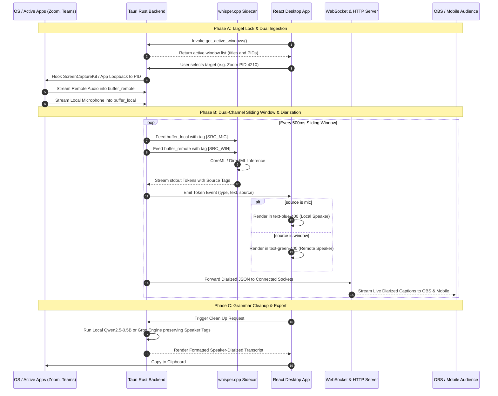

# LiveSpeak

LiveSpeak is a featherweight (under 200MB total footprint), 100% on-device, ultra-low-latency live speech-to-text (STT) desktop application with integrated local grammar correction, live event audience broadcasting, app-specific audio target locking, and zero-latency source-aware speaker diarization. Engineered using Tauri v2, native Rust audio pipelines, and quantized neural engine sidecars, the application guarantees zero cloud reliance, sub-second transcription latency, hardware-accelerated inference across Apple Silicon and Windows ARM64/x64 architectures, and driverless isolation of meeting audio.

---

## 1. Executive Summary & Core Constraints

### 1.1 Objective
Deliver a production-ready, local-first dictation, meeting transcription, and live-event broadcasting platform that operates without network latency, preserves absolute user privacy, isolates target application audio at the process ID (PID) level, and renders zero-latency speaker diarization through source-based color coding in a floating glassmorphic interface, OBS stream overlays, and local audience mobile sync.

### 1.2 Performance & Budgetary Constraints
* **Total Binary & Asset Footprint:** Under 200 MB combined (Tauri v2 host binary, whisper.cpp sidecar binary, quantized GGUF weights, and static assets).
* **Latency Profile:** Sub-second response time with continuous sliding-window token streaming (partial tokens rendered in under 350ms; final tokens within 800ms).
* **Network Independence:** Zero cloud reliance for transcription, grammar correction, and local audience broadcasting; air-gapped security compliance.
* **Hardware Acceleration Targets:**
  * Apple Silicon: M-Series Neural Engine via CoreML backend compilation.
  * Windows: Qualcomm Snapdragon ARM64 and AMD/Intel x86_64 via DirectML backend compilation.
* **Audio Routing Capabilities:** Multi-channel audio ingestion supporting physical microphone input, global system audio loopback, and PID-level target window isolation (macOS ScreenCaptureKit and Windows Application Loopback).
* **Diarization Engine:** Zero-latency, zero-overhead source-based diarization (distinguishing local speaker from remote participants without heavy biometric AI models).
* **Form Factor & Broadcasting:** Frameless, borderless, floating glassmorphic overlay adhering to native macOS and modern Windows visual paradigms, accompanied by an OBS transparent browser source and a zero-install LAN QR broadcast mode.

---

## 2. High-Organization System Architecture


The following diagram details the multi-tier architectural topology of LiveSpeak, highlighting process boundaries, inter-process communication (IPC), hardware acceleration routes, app-specific target lock, dual-buffer source-aware diarization, sliding-window streaming, and LAN audience distribution.

```mermaid
graph TB
    subgraph Host_Environment["Host Operating System Layer"]
        OS_Mic["Physical Audio Input (Local Microphone)"]
        OS_Target_Mac["Target App Window Audio (macOS ScreenCaptureKit PID Filter)"]
        OS_Target_Win["Target App Window Audio (Windows Application Loopback PID)"]
        OS_SysAudio["Global System Audio (WASAPI / ScreenCaptureKit)"]
        OS_Hotkeys["Global OS Shortcut Service (Cmd+Shift+Space / Ctrl+Shift+Space)"]
        OS_Clipboard["System Clipboard API"]
    end

    subgraph Tauri_Core["Tauri v2 Native Runtime (Rust Backend)"]
        subgraph Target_Isolation["Process ID Audio Target Lock"]
            Window_Enumerator["Window Enumerator (get_active_windows)"]
            PID_Router["Process Audio Stream Router"]
        end

        subgraph Audio_Pipeline["Dual-Channel Audio Ingestion Pipeline"]
            Buffer_Local["buffer_local: Circular Ring Buffer (Mic)"]
            Buffer_Remote["buffer_remote: Circular Ring Buffer (Target Window)"]
            Silero_VAD["Dual Silero VAD Engines (Local & Remote)"]
            Sliding_Window["Continuous 3-Second Sliding Window Slicer"]
        end

        subgraph Orchestration_Layer["Process & Event Orchestration"]
            Shortcut_Handler["Global Shortcut Controller"]
            Window_Controller["Window State & Z-Index Manager"]
            IPC_Bridge["Tauri IPC Event Dispatcher"]
            Sidecar_Manager["Sidecar Process Lifecycle Manager"]
            Token_Classifier["Token & Source Tag Classifier (PARTIAL vs FINAL)"]
        end

        subgraph Broadcast_Engine["Live Event LAN Broadcaster"]
            WS_Server["Tokio-Tungstenite WebSocket Server (ws://localhost:8080)"]
            LAN_Resolver["LAN IP Resolver & QR Generator"]
            Static_Server["Embedded HTTP Receiver Server"]
        end

        subgraph Local_NLP["Grammar Remediation Pipeline"]
            Grammar_Router["Grammar Execution Router"]
            LLM_Sidecar_Bridge["llama.cpp Subprocess Client"]
            Cloud_Fallback["Groq Low-Latency Fallback Client"]
        end
    end

    subgraph AI_Sidecars["Isolated Sidecar Executables"]
        Whisper_Sidecar["whisper.cpp Binary (Dual-Thread / Interleaved Stream)"]
        Llama_Sidecar["llama.cpp Binary (Subprocess)"]
        subgraph Hardware_Engines["Hardware Acceleration Backends"]
            CoreML_Engine["Apple Neural Engine (CoreML)"]
            DirectML_Engine["Windows GPU/NPU (DirectML)"]
        end
    end

    subgraph Storage_Layer["On-Device Model Storage (Under 200MB)"]
        Whisper_Weights["tiny.en / base.en (GGUF Quantized, 75MB - 140MB)"]
        Grammar_Weights["Qwen2.5-0.5B-Instruct (Q4_K_M GGUF, ~350MB Opt / API Fallback)"]
        VAD_Weights["Silero VAD ONNX (~2MB)"]
    end

    subgraph UI_Layer["Frontend Presentation Shell (React + TypeScript)"]
        Root_Widget["Frameless Glassmorphic Container"]
        Target_Dropdown["Target App Window Selector (Zoom, Teams, etc.)"]
        Audio_Visualizer["Framer Motion Waveform Visualizer"]
        Transcript_Stream["Color-Coded Diarized Stream (Blue: Local / Green: Remote)"]
        Action_Toolbar["Cleanup, Clipboard & Broadcast Controls"]
        QR_Modal["Live Event QR Code Display"]
    end

    subgraph External_Clients["Audience & Streaming Consumers"]
        OBS_Client["OBS Studio (Browser Source Overlay)"]
        Mobile_Audience["Mobile Phones via Local WiFi (LAN Web View)"]
    end

    %% Process Routing & Target Lock
    Target_Dropdown -->|Invoke: get_active_windows| Window_Enumerator
    Window_Enumerator --> Target_Dropdown
    Target_Dropdown -->|Set Target PID| PID_Router
    OS_Target_Mac --> PID_Router
    OS_Target_Win --> PID_Router
    OS_SysAudio --> PID_Router

    %% Dual Audio Ingestion
    OS_Mic -->|Local Voice PCM| Buffer_Local
    PID_Router -->|Isolated App Audio PCM| Buffer_Remote

    %% Dual Buffers to Slicers
    Buffer_Local --> Silero_VAD
    Buffer_Remote --> Silero_VAD
    Buffer_Local --> Sliding_Window
    Buffer_Remote --> Sliding_Window

    %% Sidecar Inference with Source Metadata
    Sliding_Window -->|Pipe Chunks with Channel Tags| Sidecar_Manager
    Silero_VAD -->|VAD Chunks with Channel Tags| Sidecar_Manager
    Sidecar_Manager -->|Stream Audio Chunks| Whisper_Sidecar
    Whisper_Weights -.->|mmap Model Weights| Whisper_Sidecar
    Whisper_Sidecar --> CoreML_Engine
    Whisper_Sidecar --> DirectML_Engine
    Whisper_Sidecar -->|stdout Tokens with Metadata| Token_Classifier

    %% Internal Token Dispatch with Source Diarization
    Token_Classifier -->|Emit: token-stream payload - source: mic or window| IPC_Bridge
    IPC_Bridge --> Transcript_Stream

    %% Broadcasting Dispatch
    Token_Classifier -->|Broadcast Diarized Payload| WS_Server
    WS_Server -->|Local WebSocket Stream| OBS_Client
    WS_Server -->|LAN WebSocket Stream| Mobile_Audience
    LAN_Resolver -->|IP URL QR Code| QR_Modal
    Static_Server -->|Serve /broadcast UI| OBS_Client
    Static_Server -->|Serve /broadcast UI| Mobile_Audience

    %% Hotkeys & Controls
    OS_Hotkeys --> Shortcut_Handler
    Shortcut_Handler --> Audio_Pipeline
    Shortcut_Handler --> IPC_Bridge
    IPC_Bridge --> Audio_Visualizer

    %% Cleanup Pipeline
    Action_Toolbar -->|Invoke: clean_transcript| IPC_Bridge
    IPC_Bridge --> Grammar_Router
    Grammar_Router -->|Local Path| LLM_Sidecar_Bridge
    Grammar_Router -->|API Path| Cloud_Fallback
    LLM_Sidecar_Bridge --> Llama_Sidecar
    Grammar_Weights -.->|mmap| Llama_Sidecar
    Llama_Sidecar --> CoreML_Engine
    Llama_Sidecar --> DirectML_Engine
    Grammar_Router --> IPC_Bridge
    IPC_Bridge --> Transcript_Stream
    Action_Toolbar --> OS_Clipboard
```



---

## 3. End-to-End Data Flow & Lifecycle State Machine

The runtime supports multi-channel audio capture, PID-level target isolation, and zero-latency source diarization alongside continuous live event streaming.



---

## 4. Technical Stack Specifications

### 4.1 Application Framework
* **Tauri v2:** Rust-based desktop orchestration framework. Eliminates Chromium and Node.js runtimes to keep memory consumption below 60MB RAM and compiled binary footprints under 15MB.
* **Rust Toolchain:** Stable channel, 2021 edition, with multi-threaded async execution powered by Tokio.

### 4.2 Frontend Architecture
* **View Layer:** React 18 with TypeScript.
* **Routing:** Dual-view architecture:
  * Primary View (`/`): Frameless, glassmorphic floating controller, target window dropdown, and color-coded diarized transcript panel.
  * Broadcast View (`/broadcast`): Transparent overlay view (`rgba(0,0,0,0)`) designed for OBS Studio Browser Sources and mobile responsive rendering.
* **Styling Engine:** Tailwind CSS configured with custom backdrop-filter and dynamic source color classes (`text-blue-400` for local speaker, `text-green-400` for remote meeting participants).
* **Animation Suite:** Framer Motion for hardware-accelerated micro-interactions, layout transitions, and pulsating audio meters.
* **Component Primitives:** Radix UI unstyled accessibility primitives.

### 4.3 Audio Capture, Target Lock & Activity Detection
* **Microphone Input:** `cpal` (Cross-Platform Audio Library) capturing 16,000 Hz, 16-bit, mono channel PCM streams into `buffer_local`.
* **Process-Specific Target Lock (macOS):** Native `ScreenCaptureKit` bindings via Rust, filtering audio capture exclusively to an explicit `SCWindow` or `SCRunningApplication` instance based on PID.
* **Process-Specific Target Lock (Windows):** Windows Application Loopback API via modern WASAPI activation targeting an individual process tree (e.g., isolating `Zoom.exe` or `Teams.exe`), eliminating ambient system dings and notification chimes.
* **Dual Ring Buffers:** Independent circular ring buffers (`buffer_local` and `buffer_remote`) preventing channel bleeding.
* **VAD Engine:** Silero VAD packaged in ONNX format (~2MB), executed via `ort` (ONNX Runtime bindings for Rust) monitoring both channels independently.
* **Continuous Streamer:** 3-second sliding window processor with 500ms step increments for unbroken live event broadcasting.

### 4.4 Speech-to-Text Engine
* **Inference Core:** `whisper.cpp` compiled as a relocatable external sidecar binary with stream processing flags enabled.
* **Model Topology:** OpenAI Whisper `tiny.en` (~75MB) or `base.en` (~140MB) quantized to GGUF format.
* **Acceleration Bindings:**
  * macOS: `-DWHISPER_COREML=ON` utilizing the Apple Silicon Neural Engine (ANE).
  * Windows: `-DWHISPER_DIRECTML=ON` offloading to local DirectX 12 compatible NPUs and GPUs.

### 4.5 Live Broadcasting & Network Subsystem
* **WebSocket Engine:** `tokio-tungstenite` lightweight async WebSocket server running on local port `8080`.
* **Local Discovery:** `local-ip-address` crate for resolving the host machine's LAN IP address.
* **QR Code Engine:** `qrcode` crate generating base64 PNG and SVG data URLs directly in Rust for immediate display in the React UI.
* **OBS Integration:** Pure transparent HTML/CSS endpoint compatible with OBS Studio Browser Source (`rgba(0,0,0,0)` background).

### 4.6 Grammar Correction & Post-Processing
* **Primary (Local Execution):** `llama.cpp` sidecar executing Qwen2.5-0.5B-Instruct in 4-bit quantization (Q4_K_M).
* **Secondary (Low-Storage Compliance):** High-speed fallback API (Groq running Llama-3.1-8B-Instant) for environments demanding strict under-200MB total disk boundaries where local LLM weights cannot be stored.
* **Operations:** Disfluency and filler word removal, punctuation restoration, casing correction, and context-aware sentence restructuring while preserving speaker separation metadata.

### 4.7 Product Web Asset
* **Framework:** Next.js 14 (App Router) with static export capability (`output: export`).
* **Design Aesthetic:** Editorial dark-mode aesthetic featuring deep charcoal backdrops, interactive canvas grids, and instant download matrices.

---

## 5. Memory, Storage & Latency Budget

To strictly honor the 200MB total distribution limit while providing real-time responsiveness, target-locking, and live broadcasting, assets and resources are allocated according to the matrix below:

| Component | Storage Size | Runtime Memory (RAM) | Primary Execution Target |
| :--- | :--- | :--- | :--- |
| Tauri Host Binary (Stripped) | 12.8 MB | 30 MB - 45 MB | CPU (Native Thread) |
| Web UI Assets (Desktop + Broadcast UI) | 2.8 MB | Shared WebView | WebKit / WebView2 |
| whisper.cpp Sidecar Executable | 4.8 MB | 15 MB | CPU / Subprocess |
| Silero VAD ONNX Model | 1.8 MB | 10 MB | CPU / ONNX Runtime |
| Whisper `tiny.en` Model (GGUF) | 75.0 MB | 110 MB | Apple Neural Engine / DirectML |
| Dynamic Libraries (CoreML / ONNX / DirectML) | 45.0 MB | Shared Virtual Mem | OS Dynamic Linker |
| Dual Buffer & PID Stream Router | Included in host | 8 MB - 12 MB | Transient Memory Pool |
| WebSocket & Embedded Server Runtime | Included in host | 4 MB - 8 MB | Async Tokio Pool |
| Application Config & Caches | < 1.0 MB | < 2 MB | Local Storage |
| **Total Core Configuration** | **~143.2 MB** | **~180 MB - 225 MB** | **Sub-200MB Target Met** |

---

## 6. Repository Layout

```
LiveSpeak/
|-- .gitignore
|-- README.md
|-- package.json
|-- apps/
|   |-- desktop/                          # Tauri v2 Desktop Application
|   |   |-- package.json
|   |   |-- tsconfig.json
|   |   |-- vite.config.ts
|   |   |-- index.html
|   |   |-- src/                          # React Frontend Shell
|   |   |   |-- main.tsx
|   |   |   |-- App.tsx
|   |   |   |-- index.css
|   |   |   |-- routes/
|   |   |   |   |-- WidgetView.tsx        # Main floating desktop widget
|   |   |   |   |-- BroadcastView.tsx     # Transparent OBS / Mobile receiver
|   |   |   |-- components/
|   |   |   |   |-- GlassContainer.tsx    # Frameless floating shell
|   |   |   |   |-- TargetDropdown.tsx    # Active window / PID selector
|   |   |   |   |-- AudioSourceToggle.tsx # Mic vs. Target vs. System Audio
|   |   |   |   |-- RecordButton.tsx      # Reactive pulse trigger
|   |   |   |   |-- AudioVisualizer.tsx   # Dual-channel soundwave
|   |   |   |   |-- DiarizedTranscript.tsx # Color-coded speaker transcript
|   |   |   |   |-- ActionToolbar.tsx     # Clean up, clipboard & broadcast
|   |   |   |   |-- QRCodeModal.tsx       # Live event LAN connection QR
|   |   |   |-- hooks/
|   |   |   |   |-- useAudioCapture.ts
|   |   |   |   |-- useActiveWindows.ts   # Queries get_active_windows
|   |   |   |   |-- useTauriEvents.ts
|   |   |   |   |-- useBroadcastSocket.ts
|   |   |   |-- types/
|   |   |       |-- transcript.ts         # { type, text, source: 'mic' | 'window' }
|   |   |       |-- window.ts             # { window_name, process_id }
|   |   |-- src-tauri/                    # Rust Native Host
|   |       |-- Cargo.toml
|   |       |-- tauri.conf.json           # Window transparency & sidecars
|   |       |-- build.rs
|   |       |-- bin/                      # Compiled sidecar target folder
|   |       |   |-- whisper-sidecar-aarch64-apple-darwin
|   |       |   |-- whisper-sidecar-x86_64-pc-windows-msvc.exe
|   |       |-- models/                   # Quantized offline weights
|   |       |   |-- ggml-tiny.en-q5_1.bin
|   |       |   |-- silero_vad.onnx
|   |       |-- src/
|   |           |-- main.rs
|   |           |-- lib.rs
|   |           |-- audio/
|   |           |   |-- mod.rs
|   |           |   |-- capture.rs        # CPAL input stream manager
|   |           |   |-- target_mac.rs     # ScreenCaptureKit PID filter
|   |           |   |-- target_win.rs     # Windows Application Loopback PID
|   |           |   |-- loopback_win.rs   # Global WASAPI loopback
|   |           |   |-- dual_buffer.rs    # buffer_local & buffer_remote ring buffers
|   |           |   |-- sliding_window.rs # 3s continuous sliding window
|   |           |   |-- vad.rs            # Silero ONNX dual evaluation
|   |           |   |-- wav.rs            # Memory WAV serialization
|   |           |-- broadcast/
|   |           |   |-- mod.rs
|   |           |   |-- websocket.rs      # Tokio-tungstenite socket server
|   |           |   |-- qr.rs             # LAN IP detection & QR generator
|   |           |-- engine/
|   |           |   |-- sidecar.rs        # Subprocess lifecycle & stdout
|   |           |   |-- parser.rs         # Token & source metadata classifier
|   |           |   |-- grammar.rs        # Text post-processing router
|   |           |-- commands/
|   |           |   |-- windows.rs        # get_active_windows implementation
|   |           |   |-- recording.rs      # Audio start/stop & target selection
|   |           |   |-- broadcast.rs      # Live event broadcast triggers
|   |           |   |-- clipboard.rs
|   |           |-- state.rs              # AppState, dual channels & PID targets
|   |-- web/                              # Product Marketing Asset
|       |-- package.json
|       |-- next.config.mjs
|       |-- tailwind.config.ts
|       |-- tsconfig.json
|       |-- app/
|           |-- layout.tsx
|           |-- page.tsx
|           |-- globals.css
|           |-- components/
|               |-- HeroSection.tsx
|               |-- DesktopDemoMock.tsx
|               |-- LiveEventBroadcastDemo.tsx
|               |-- DownloadMatrix.tsx
|               |-- ArchitectureDeepDive.tsx
|-- scripts/                              # Compilation & packaging utilities
|   |-- setup_sidecars.sh                 # Sidecar build automator
|   |-- download_models.sh                # Weight verification & download
```

---

## 7. Subsystem Deep Dive: Core Desktop Features

### 7.1 Window Shell & Glassmorphic Styling
To achieve the native macOS floating widget aesthetic without borders or chrome:

1. **Tauri Window Configuration (`tauri.conf.json`):**
   ```json
   {
     "app": {
       "windows": [
         {
           "title": "LiveSpeak",
           "width": 420,
           "height": 580,
           "resizable": false,
           "decorations": false,
           "transparent": true,
           "alwaysOnTop": true,
           "skipTaskbar": false,
           "shadow": true
         }
       ]
     }
   }
   ```
2. **Glassmorphic Layering:**
   The top-level container applies an explicit frosted-glass composition using:
   ```css
   .glass-container {
     background: rgba(18, 18, 22, 0.65);
     backdrop-filter: blur(20px) saturate(180%);
     -webkit-backdrop-filter: blur(20px) saturate(180%);
     border: 1px solid rgba(255, 255, 255, 0.08);
     box-shadow: 0 20px 40px -15px rgba(0, 0, 0, 0.5),
                 0 0 0 1px rgba(255, 255, 255, 0.05) inset;
   }
   ```

### 7.2 Push-to-Talk & Dictation Silence Slicing
* The `cpal` worker thread samples input hardware at 16,000 Hz (single channel, float32 normalized).
* Samples are continuously pumped into an atomic circular ring buffer.
* The Silero VAD processor operates on fixed 512-sample blocks (32ms per frame). A probability rating is generated per block:
  * Speech Start: Probability > 0.55 sustained over 3 consecutive frames triggers an active audio segment.
  * Speech End: Probability < 0.35 sustained over 400ms marks the termination of speech.
* Upon termination, the buffered samples (including a 150ms pre-roll to prevent front-clipping of plosives) are converted to a 16-bit linear PCM WAV container in memory.

### 7.3 Grammar Cleanup Pipeline
* The "Clean Up" module accepts the raw transcription string and executes a targeted prompt:
  ```
  [INST] System: You are an expert speech editor. Remove speech disfluencies, filler words (um, uh, like), fix punctuation, and correct casing while preserving speaker tags. Retain original vocabulary and intent without editorial commentary.
  Raw: {RAW_TRANSCRIPTION}
  Cleaned: [/INST]
  ```
* Output is streamed back to replace the raw buffer and automatically presented with an instant copy action button.

---

## 8. Live Event & Real-Time Streaming Architecture

To handle large-scale live events, LiveSpeak transcends standard push-to-talk dictation. Live events necessitate capturing system audio (for virtual conferences like Zoom, Microsoft Teams, or YouTube Live), continuous sub-second text streaming (eliminating pauses between sentences), and local audience broadcasting.

### 8.1 Advanced Audio Capture (System Audio vs. Microphone)
* **The Problem:** Capturing physical microphone input is straightforward, but capturing a live virtual event (system audio) requires bypassing OS restrictions, particularly on macOS where loopback drivers typically require complex kernel installations.
* **The Solution:** Dual-source audio selector integrated in the UI backed by native platform capture mechanisms:
  * **Windows Implementation:** Utilizes Rust's `cpal` crate configured with WASAPI loopback mode (`AUDCLNT_STREAMFLAGS_LOOPBACK`). This records system output audio natively from the default render device without third-party virtual audio cables.
  * **macOS Implementation:** Leverages Apple's native `ScreenCaptureKit` API via Rust bindings. This captures audio directly from specific running applications or global system output without requiring users to install third-party drivers like BlackHole or Soundflower.

### 8.2 Continuous Sliding-Window Processing (Sub-Second Latency)
* **The Problem:** Standard Voice Activity Detection (VAD) waits for a conversational pause before dispatching an audio chunk. During a keynote or presentation, a speaker may talk continuously for minutes without pausing, creating massive caption latency.
* **The Solution:** A continuous sliding-window streaming architecture powered by `whisper.cpp` in stream mode:
  * The Rust backend continuously feeds a 3-second sliding window of audio (stepped forward every 500ms) to the inference sidecar.
  * The model outputs classified tokens:
    * `[PARTIAL]` Tokens: Tentative words currently being predicted, displayed in real time in a muted, italicized style.
    * `[FINAL]` Tokens: Confirmed sentence fragments locked into history and rendered in solid text.
  * The React frontend dynamically reconciles active `[PARTIAL]` text, creating the immediate "live typing" effect standard in professional broadcasting.

### 8.3 Audience Broadcasting & Presentation Mode
* **The Problem:** Captions in hybrid or physical events are trapped on the operator's display. Audiences and livestream viewers require instant access.
* **The Solution:** An embedded local broadcast module within the Tauri runtime:
  * **Local WebSocket Server:** The Rust backend instantiates an asynchronous WebSocket server (`tokio-tungstenite`) bound to `ws://0.0.0.0:8080`.
  * **OBS Studio Integration (Streamers):** The app serves a dedicated transparent route (`/broadcast`). Streamers paste `http://localhost:8080/broadcast` directly into an OBS Studio "Browser Source" to overlay transparent live subtitles with zero background artifacts.
  * **QR Code Audience Mode (In-Person Events):** Clicking "Start Live Event Mode" resolves the host's local IP address (e.g., `http://192.168.1.45:8080/broadcast`) and generates a scannable QR code on the desktop interface. Audience members scan the code with their mobile devices to open an interactive, responsive live caption reader connected directly to the host over local Wi-Fi.

---

## 9. Targeted Capture & Source-Aware Diarization Architecture

### 9.1 App-Specific Audio Capture (The "Target Lock" Feature)
* **The Problem:** Capturing global system audio means every background Slack notification chime, OS error ding, or ambient YouTube video gets mixed into the audio pipeline, triggering hallucinated words and polluting meeting transcripts.
* **The Solution:** Process ID (PID) level audio isolation that locks strictly onto the chosen application:
  * **macOS Implementation:** Leverages Apple's `ScreenCaptureKit` framework, which natively supports filtering audio captures to an exact `SCRunningApplication` or `SCWindow` descriptor. Audio from unselected apps is discarded at the OS level before reaching the application buffer.
  * **Windows Implementation:** Utilizes the Windows Application Loopback API (via `AUDCLNT_STREAMFLAGS_AUTOCONVERTPCM` and `ActivateAudioInterfaceAsync` targeting a specific process ID). Audio is captured exclusively from the selected process tree (e.g., isolating `Zoom.exe` or `Teams.exe`).
  * **UI & Workflow Integration:** The React interface provides a "Select Target" dropdown. The user triggers target selection, Rust queries active windows via `get_active_windows()`, and the user binds LiveSpeak directly to the target meeting window.

### 9.2 Source-Aware Diarization (Zero-Latency Color Coding)
* **The Problem:** Traditional speaker diarization frameworks (e.g., Pyannote) require heavy neural models (adding 150MB+ to binary footprints, violating our 200MB limit) and introduce noticeable latency by analyzing voice acoustic embeddings before emitting text.
* **The Solution:** Zero-overhead, zero-latency Source-Based Diarization:
  * **Stream Isolation:** LiveSpeak already controls audio ingestion at the OS boundary. The local microphone audio (`Stream A`) is guaranteed to be the local user. The targeted meeting window audio (`Stream B`) is guaranteed to be the remote participants.
  * **Dual Isolated Channels:** Audio is maintained in two distinct buffers (`buffer_local` and `buffer_remote`) rather than being mixed into a single mono track.
  * **Metadata Tagging:** When speech chunks are dispatched to the `whisper.cpp` sidecar, they carry their source channel tag (`SRC_MIC` vs. `SRC_WIN`).
  * **Dynamic UI Rendering:**
    * Local Speaker (`source === "mic"`): Styled with Tailwind class `text-blue-400`.
    * Remote Speaker (`source === "window"`): Styled with Tailwind class `text-green-400`.
  * **Result:** Instant, 100% deterministic speaker separation with zero additional model weights and zero latency penalty.

---

## 10. Step-by-Step AI Execution Plan

### Phase 1: Environment & Framework Initialization
* Scaffold the Tauri v2 monorepo using React and TypeScript templates.
* Configure `tauri.conf.json` with transparency, frameless decorations, fixed dimensions (420x580), and `alwaysOnTop: true`.
* Initialize Tailwind CSS with custom alpha-channel variables and backdrop blur utility classes.
* Implement the baseline UI: frameless container, titlebar drag region, central record trigger, and transcript window.

### Phase 2: Global State & OS Integration
* Integrate `@tauri-apps/plugin-global-shortcut` and configure standard OS triggers (`Cmd+Shift+Space` on macOS, `Ctrl+Shift+Space` on Windows).
* Create an atomic state struct in Rust to guard recording lifecycle flags (`is_recording`, `is_processing`, `audio_source`, `target_pid`).
* Implement bidirectional state synchronizers: Rust shortcuts emit events to React; UI clicks dispatch commands to Rust.
* Configure window drag handlers via `data-tauri-drag-region` to allow free screen positioning.

### Phase 3: The Audio Capture & VAD Pipeline (Rust Backend)
* Add `cpal`, `hound`, and `ort` dependencies to `src-tauri/Cargo.toml`.
* Spawn a dedicated real-time audio thread executing the `cpal` event loop.
* Build a lock-free ring buffer holding up to 30 seconds of rolling audio data.
* Load `silero_vad.onnx` into ONNX Runtime with execution providers tuned to the native platform.
* Implement the state machine that accumulates audio during active speech and flushes structured in-memory WAV chunks when trailing silence criteria are met.

### Phase 4: whisper.cpp Integration (The AI Engine)
* Clone and compile `whisper.cpp` sidecar binaries:
  * macOS: Build targeting `darwin-universal` or `darwin-aarch64` with CoreML delegate.
  * Windows: Build targeting `x86_64-pc-windows-msvc` or `aarch64-pc-windows-msvc` with DirectML delegate.
* Place binary artifacts in `src-tauri/bin/` with Tauri sidecar naming conventions.
* Implement sidecar process spawning logic in `sidecar.rs`, piping the memory WAV buffer to standard input or passing path references.
* Capture stdout output chunks asynchronously and emit real-time string fragments to the frontend.

### Phase 5: The Grammar Correction Module
* Add the conditional "Clean Up" toolbar button in the React UI that reveals itself once transcription text is present.
* Create the backend IPC handler `clean_transcript`.
* Implement the execution provider:
  * Route A: Direct execution through `llama.cpp` sidecar with quantized `Qwen2.5-0.5B`.
  * Route B: Zero-local-overhead execution via high-speed Groq API client with sub-250ms response times.
* Replace raw text in the UI with cleaned content while preserving speaker markers, binding the "Copy" action to the system clipboard via `@tauri-apps/plugin-clipboard-manager`.

### Phase 6: Product Landing Page (Next.js 14 App Router)
* Initialize the static marketing asset under `apps/web/`.
* Design a high-contrast editorial dark theme matching the desktop glassmorphic design language.
* Implement dynamic hardware detection recommending either the Apple Silicon M-Series package (~185MB) or Windows package (~190MB).
* Incorporate feature comparisons, architecture diagrams, and air-gapped security validations.

### Phase 7: System Audio & Loopback Integration
* Update the Rust audio module to enumerate and bind both Input Devices (Microphones) and Output Devices (System Audio).
* Implement WASAPI loopback capture on Windows via `cpal` loopback device streams.
* Implement native `ScreenCaptureKit` audio capture routing for macOS build targets without third-party drivers.
* Add an audio source selector toggle in the React UI: "Mic Input" vs. "System Audio".

### Phase 8: Streaming Token UI Implementation
* Modify the Tauri event listener in React to parse typed payload objects: `{ type: "partial" | "final", text: string, source: "mic" | "window" }`.
* Build a rendering component that commits `[FINAL]` tokens to solid text blocks.
* Append the active `[PARTIAL]` string to the active block with distinct transitional styling (opacity 0.5, italicized, fast transition) to create the sub-second live typing effect.

### Phase 9: WebSocket Broadcaster & QR Code Generation
* Embed a `tokio-tungstenite` asynchronous WebSocket server in the Rust runtime broadcasting `{ type, text, source }` payloads.
* Build the `/broadcast` route in React featuring a transparent background (`rgba(0, 0, 0, 0)`) for direct embedding into OBS Studio Browser Sources.
* Implement LAN IP resolution (e.g., `192.168.1.X`) and QR code SVG generation in Rust, rendering a scannable overlay modal when "Start Live Event Mode" is triggered.

### Phase 10: Process-Level Audio Isolation (Target Lock)
* Implement the Rust command `get_active_windows()` querying native OS APIs (CoreGraphics/WindowServer on macOS, Win32 `EnumWindows` on Windows) returning a list of `{ window_name: string, process_id: number }`.
* Build a dropdown selector in the React UI to list and search active windows.
* Update audio capture logic: When a `process_id` is passed, initialize `ScreenCaptureKit` (macOS) or Application Loopback (Windows) attached strictly to that PID, ignoring ambient desktop noise.

### Phase 11: Multi-Threaded Audio Routing for Color-Coding
* Configure the audio subsystem to maintain two isolated channels: `buffer_local` for microphone audio and `buffer_remote` for target window audio.
* Run Silero VAD monitoring concurrently across both buffers.
* Attach metadata markers (`SRC_MIC` and `SRC_WIN`) to audio segments dispatched to `whisper.cpp`.
* Update frontend state to render `source: "mic"` in `text-blue-400` (Local Speaker) and `source: "window"` in `text-green-400` (Remote Speaker).

---

## 11. Compilation & Build Matrix

### 11.1 Compiling whisper.cpp Sidecars

#### macOS (Apple Silicon M-Series with CoreML)
```bash
git clone https://github.com/ggerganov/whisper.cpp.git
cd whisper.cpp
cmake -B build \
  -DWHISPER_COREML=ON \
  -DWHISPER_COREML_ALLOW_FALLBACK=ON \
  -DCMAKE_BUILD_TYPE=Release
cmake --build build --config Release -j$(sysctl -n hw.ncpu)

# Rename to match Tauri target triple
cp build/bin/whisper-cli ../src-tauri/bin/whisper-sidecar-aarch64-apple-darwin
```

#### Windows (DirectML GPU/NPU Acceleration)
```powershell
git clone https://github.com/ggerganov/whisper.cpp.git
cd whisper.cpp
cmake -B build -G "Visual Studio 17 2022" -A x64 `
  -DWHISPER_DIRECTML=ON `
  -DCMAKE_BUILD_TYPE=Release
cmake --build build --config Release -j $env:NUMBER_OF_PROCESSORS

# Rename for Tauri sidecar runner
Copy-Item build\bin\Release\whisper-cli.exe ..\src-tauri\bin\whisper-sidecar-x86_64-pc-windows-msvc.exe
```

### 11.2 Building the Desktop Application
```bash
# Install root workspace dependencies
pnpm install

# Run development server with live reload
pnpm --filter desktop tauri dev

# Package final standalone production bundles
pnpm --filter desktop tauri build
```

---

## 12. Privacy, Security & Air-Gap Compliance

LiveSpeak is architected from first principles to be completely secure and self-contained:
* **Zero Socket Outbound Traffic:** In standard mode, the core application opens zero external TCP or UDP sockets.
* **Contained Local Broadcasting:** When Live Event Mode is active, the WebSocket server listens exclusively on the local interface or LAN subnet without external internet traversal.
* **No Telemetry or Tracking:** No analytical beacons, crash reporters, or tracking identifiers are compiled into the binary.
* **In-Memory Audio Processing:** Audio buffers are captured and analyzed exclusively in transient RAM. Audio is never written to disk, preventing forensic recovery of sensitive speech.
* **Air-Gap Verification:** The software operates seamlessly on offline workstations, high-security enclaves, and disconnected enterprise machines.

---

## 13. Verification & Acceptance Criteria

* **Storage Footprint:** Combined unpacked size of application bundle, whisper sidecar, and `tiny.en` model must not exceed 200MB.
* **Target Isolation Accuracy:** Audio captured in Target Lock mode must strictly contain the target process output with zero leakage from background applications.
* **Diarization Latency:** Speaker color coding (`text-blue-400` vs `text-green-400`) must be assigned immediately at token emission with zero biometric processing overhead.
* **Latency Benchmark:** Partial streaming tokens must appear in the UI within 350 milliseconds of vocalization; final sentence tokens within 800 milliseconds.
* **Cold Start Time:** Initial application launch to listening readiness must complete in under 1.5 seconds.
* **Resource Idle Consumption:** In standby mode, CPU consumption must remain below 0.2% and RAM usage below 45MB.
* **Broadcast Latency:** WebSocket packet transit from host transcription to OBS and mobile browser clients must remain under 50 milliseconds on standard local Wi-Fi networks.
